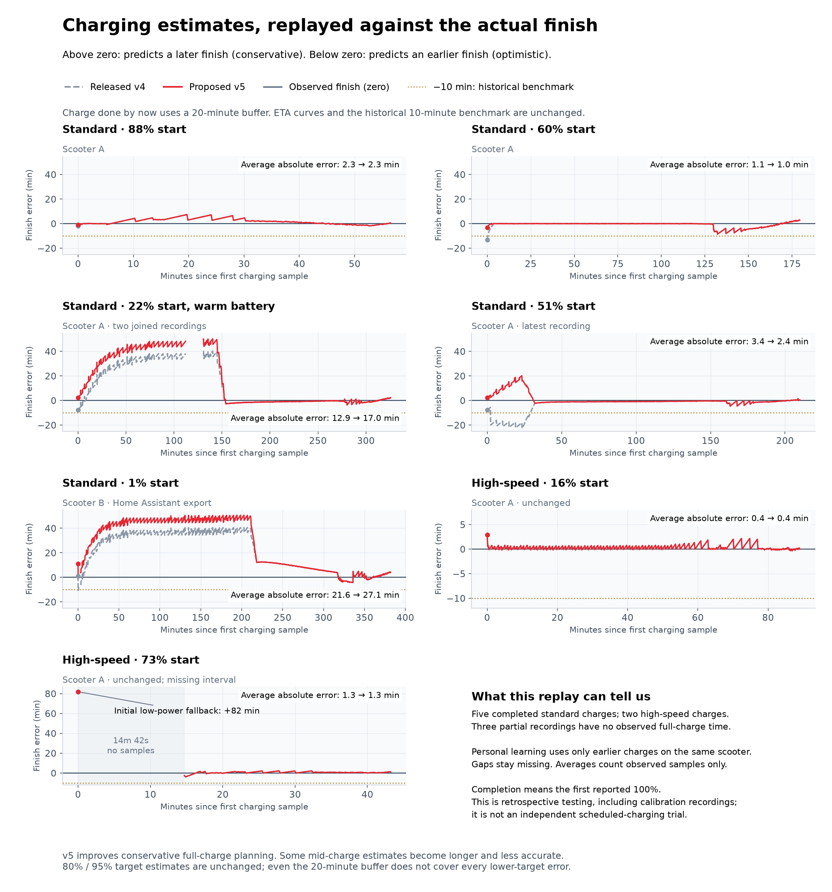

# Conservative standard-charger full-time estimates

Estimator `ut5-stock-startup-v5`, following the [voltage refinement](stock-voltage-estimates.md).

## Behavior

A standard-charger capture exposed optimistic early predictions from short,
percentage-only personal history. Another UT5 MAX showed why a fixed settled
current is unsuitable: its charger stabilized near 2.17 A, while the earlier
scooter's charger stabilized near 1.94–2.00 A. Imposing 2 A made the second
scooter's first estimate over an hour too long.

The full-time fallback keeps measured current and adds up to ten minutes for
uncertainty below 89%. The allowance fades linearly from 79% to zero at 89%.
Shorter personal full-time predictions cannot reduce this fallback in the early
bulk stage. That restriction fades over the same interval so it does not create
a jump when the existing finishing calculation resumes. Longer personal evidence
can still increase the estimate. Voltage/current matching blends against this
selected fallback; a fully admitted voltage match remains unchanged.

The allowance applies only to recognized UT5 MAX standard charging with fresh
compatible measurements and a reported capacity within 10% of 15.3 Ah. It is an
empirical planning allowance, not a measured battery-capacity correction or a
statistical confidence bound. Displayed power/current remain actual measurements.
High-speed estimates and all stock behavior at 89% or above remain unchanged.
New samples record estimator v5; saved estimates and recordings are not rewritten.

Charge done by now adds a separate twenty-minute safety buffer when calculating
the charge-start time. This replaces its former ten-minute scheduling buffer;
the estimator's up-to-ten-minute startup allowance above is unchanged. Displayed
and recorded ETAs exclude the scheduling buffer. Active UT5
charging with an unknown automatic charger family cannot arm or update a plan
until identification completes or the user selects a charger. Automatic stock
identification is unavailable above its existing 85% cutoff, so an explicit
selection may be necessary there. Disabling a plan, editing an offline preference,
and editing an owned pause with a valid captured estimate retain their paths.
There is no automatic rescheduling or background connection-policy change.

## Recorded-session comparisons

Positive error means the estimate was longer than the observed time to first
displayed 100%. These figures exclude the separate twenty-minute scheduling buffer.
The published replay metrics named `10min` retain the historical ten-minute
scheduling threshold for an unchanged before/after benchmark; their values are
not relabeled as twenty-minute results.

| Start | Previous full estimate | New full estimate | Observed time | New error |
|---|---:|---:|---:|---:|
| 60% | 166.33 min | 176.33 min | 179.54 min | −3.21 min |
| 22%, warm pack | 318.00 min | 328.00 min | 325.80 min | +2.21 min |
| 51%, later capture | 202.26 min | 212.26 min | 210.02 min | +2.24 min |
| 1%, second scooter | 383.03 min | 393.03 min | 381.99 min | +11.04 min |
| 88% | 54.58 min | 55.58 min | 56.50 min | −0.92 min |

The later 51% capture's maximum optimism in its first 30 minutes falls from
22.61 minutes to zero. Its whole-charge mean absolute error falls from 3.36 to
2.36 minutes. This deliberately favors earlier completion over average accuracy:
the warm charge's whole-charge error rises from 12.89 to 16.97 minutes, and the
second scooter's rises from 21.63 to 27.12 minutes, mostly through longer estimates.
All observed full-charge predictions in these five completed physical charges fit
inside even the former ten-minute scheduling buffer. The current buffer is twenty
minutes; the ETA calculations and replay evidence remain unchanged. This is
retrospective model selection, not a prospective guarantee or a test of a scooter
paused until a scheduled start.

The first dataset comprises ten journals and 5,618 samples, replayed both with
bundled references alone and with only preceding personal charges. Two split warm
journals represent one physical charge; their gap stays missing. A frozen v4
baseline reproduces all 1,254 saved estimates and sources in the latest capture.

The second scooter supplied Home Assistant state-change history. Its initial
100% precedes the real charging state and is excluded. Independent sensor events
are grouped within 5 ms and unchanged values held until an explicit unavailable
event. Three gaps total about 67 seconds. Approximately 10-second sampling yields
2,077 replay points; these are hypothetical paired estimator inputs, not proof
that the export preserves Bluetooth frame freshness. No personal history from
another owner is applied. Temperature units are inferred, not used by the model.
The [reproducible evidence bundle](data/stock-startup-v5/README.md) includes
anonymized measurements, preserved gaps, recorded estimate fields, replay
programs and before/after summaries. Personal identities and original calendar
timestamps remain outside the source repository. Reviewers can replay the released
v4 implementation and this candidate without either owner's phone or private files.

The two completed high-speed charges are also included. The 16% start predicts
92.07 minutes against 89.13 observed. The 73% start has a bad initial low-power
fallback: 125.18 minutes against 43.25 observed, followed by a 14m42s recording
gap. The continuous portion after that gap has 0.88-minute mean absolute error.
Both predictions are unchanged by this standard-charger refinement. Three other
partial journals have no observed completion and cannot establish finish accuracy.

## Limits and regression coverage

Lower cutoff calculations are deliberately unchanged. In particular, low-start
80% predictions can remain substantially optimistic: observed worst errors were
about 38 and 42 minutes on the warm and second-scooter charges. Even the increased
twenty-minute scheduling buffer does not cover those cases. A full-charge timing
improvement must not be presented as a guarantee for every Charge done by target; lower
cutoffs need their own calibration. The percentage gauge's rapid late rise makes
a linear percentage-to-time conversion unreliable.

Both datasets preserve every replayed 80%/95% result. All high-speed and stock
89%+ outputs remain unchanged. Tests cover first predictions on both scooters,
source attribution, shorter and longer personal curves, smooth voltage and 89%
boundaries, unknown/reached cutoffs, and independence of full time from the chosen
cutoff. Controller and native tests cover unknown-family blocking, manual selection,
cancel/disable, owned-pause edits, and scheduling confirmation. No physical charge
or scooter setting is changed by these tests.
